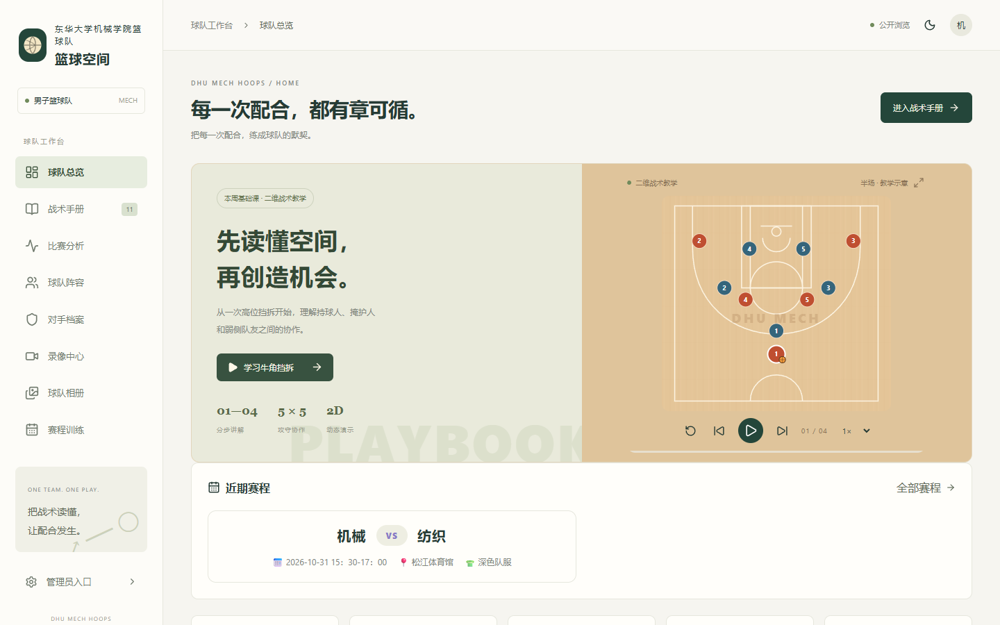
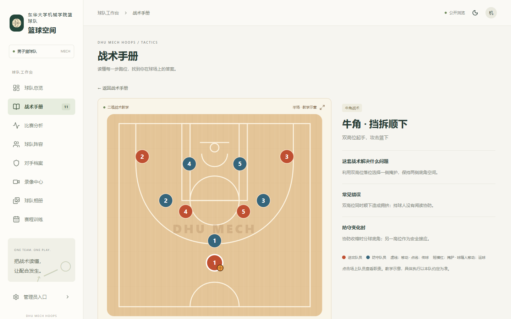
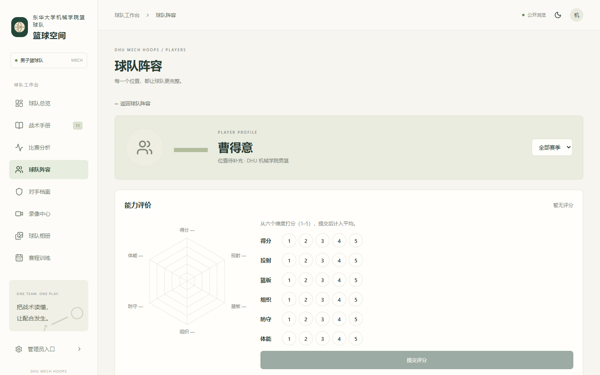
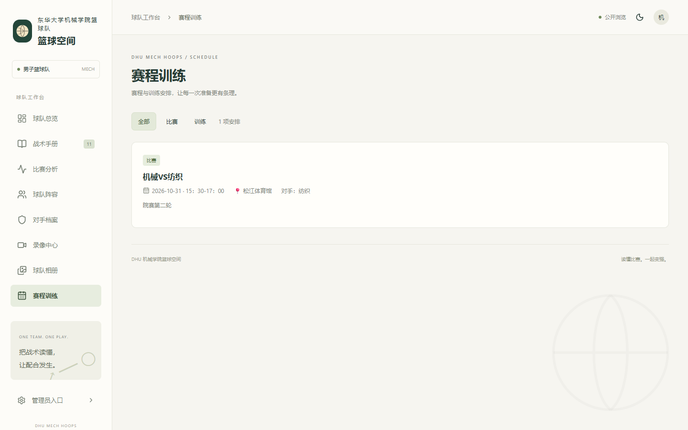
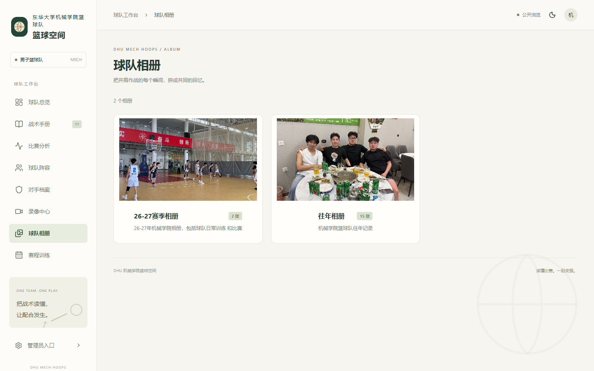
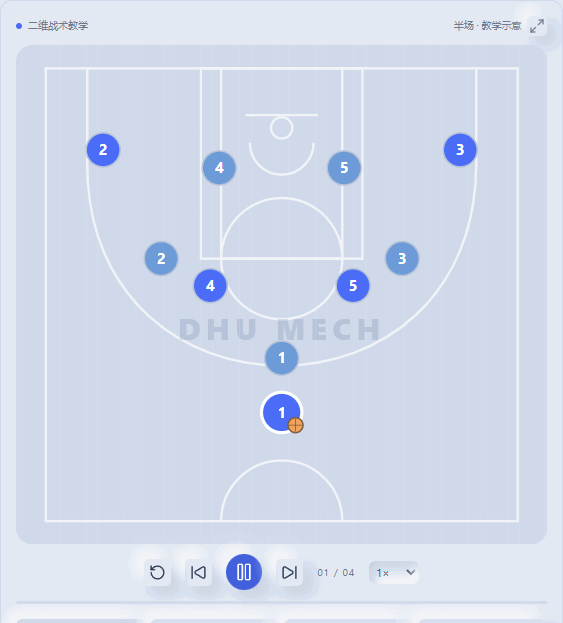

# 🏀 DHU 机械学院篮球空间

> 联网的篮球战术教学与赛后数据分析平台 —— 把每一次配合，练成球队的默契。
> An online basketball tactics teaching & post-game analytics platform.

[**English**](./README.en.md) · [变更日志](./CHANGELOG.md) · [在线演示](https://www.jxlq.top)


---

## ✨ 功能特性

| 🧭 模块 | 📝 说明 |
| --- | --- |
| 📊 球队总览 | 球队信息、队徽、主题色与赛季数据一览 |
| 📋 二维战术 | 11 套战术动画（传切、挡拆、无球掩护、牛角、快攻、联防…），可播放 / 暂停 / 慢放 / 逐步 / 放大 |
| 📈 比赛分析 | Excel / CSV 导入校验、出手命中率、趋势图、逐场复盘 |
| 👥 球队阵容 | 球员档案（头像、身高、体重、位置、籍贯、惯用手）+ 首发/替补阵容（下一场首发安排、上一场首发记录） |
| ⭐ 六维能力 | 访客匿名评分（得分/投射/篮板/组织/防守/体能），平均后生成六方图 |
| 🤖 AI 打法建议 | DeepSeek 按「数据 + 评分 + 位置」生成四段式建议（角色定位/进攻/防守/训练重点） |
| 🎯 对手档案 | 人工观察记录 + 备战建议 |
| 🎬 录像中心 | B站流媒体播放（粘贴 BV 号 / 链接），不占云端存储 |
| 🖼 球队相册 | 相册分组、封面、照片灯箱 |
| 📅 赛程训练 | 比赛与日常训练安排（时间、地点、着装要求），首页展示近期赛程 |
| 💬 复盘留言 | 比赛队员复盘、球员留言板（访客填写需填姓名） |
| 🌙 多主题 | 暖浅色 / 暖深色 / 蓝白新拟物三套主题可切换 |
| 🔐 管理员后台 | 内容管理、数据导入、草稿 / 发布、批次撤销 |
| ✉️ 登录认证 | 邮箱验证码登录 + 原 ChatGPT 管理员身份 |

## 🖼 截图

| 🏠 首页 | 📋 战术教学 |
| --- | --- |
|  |  |

| ⭐ 球员分析 | 📅 赛程训练 |
| --- | --- |
|  |  |

| 🖼 球队相册 | 🎬 战术动画演示 |
| --- | --- |
|  |  |

## 🛠 技术栈

- **前端**：Next.js 16 · React 19 · Vinext（RSC）· Tailwind CSS 4 · lucide-react
- **后端**：Cloudflare Workers · D1（SQLite）· R2（对象存储）
- **数据**：Drizzle ORM · Zod 校验
- **AI**：DeepSeek（`deepseek-chat`）
- **语言**：TypeScript

## 🚀 快速开始

> 需要 Node.js ≥ 22.13。

```powershell
npm run install:ci          # 安装依赖
node scripts/init-local-admin.mjs   # 本地管理员初始化
npm run db:generate         # 生成数据库迁移
npm run dev                 # 开发服务器
```

开发默认地址：`http://127.0.0.1:5173/`。首次运行需应用数据库迁移，详见 [部署手册](docs/部署手册.md)。

## ☁️ 部署

生产站：**https://www.jxlq.top**（Cloudflare Workers + D1 + R2）。

```powershell
npm run deploy:cf           # 构建 + 守卫检查 + wrangler deploy
```

完整步骤、密钥配置与故障排查见 [部署手册](docs/部署手册.md)。

## 📚 文档

| 📄 文档 | 📝 说明 |
| --- | --- |
| [部署手册](docs/部署手册.md) | 生产部署、密钥、回滚、故障排查 |
| [产品方案](docs/产品方案.md) | 需求、页面结构、数据模型、实施顺序 |
| [UI 风格](docs/UI风格.md) | 配色、布局、视觉语义、深色主题 |
| [邮箱登录配置](docs/邮箱登录配置.md) | 邮箱验证码登录接入说明 |
| [验收结果](docs/验收结果.md) | 各阶段验收记录与已知限制 |
| [变更日志](CHANGELOG.md) | 里程碑与功能进展 |

## 🗺 路线图

- ✅ **第一阶段**：公开浏览、管理员权限、导入校验、二维战术、对手档案、录像图片
- ✅ **第二阶段**：深色模式、球队相册、球员六维分析与 AI 打法建议、首发/替补阵容、B站视频、籍贯
- ✅ **第三阶段**：赛程与训练安排、蓝白新拟物主题、比赛队员复盘、球员留言板
- ⏳ **规划中**：视频时间片段标注、战术与录像联动、自由绘制、定制分析助手
- 💭 **远期**：真实样本验证后的自动事件识别、追踪、三维教学

详见 [变更日志](CHANGELOG.md)。

## 🤝 开源与贡献

本项目使用 **MIT License** 开源，欢迎提 Issue 与 Pull Request。开始前请先阅读 [产品方案](docs/产品方案.md) 了解架构约定。

## 🔒 安全说明

本仓库**只包含代码**，不包含任何密钥、凭证或生产数据：

- `.dev.vars`、`.env*`、`old-data.json`、`restore.sql`、`backup-*.sql` 均已被 `.gitignore` 忽略；
- 生产站 `www.jxlq.top` 的数据（D1）与媒体（R2），以及部署凭证（Cloudflare、DeepSeek、管理员口令）都不在仓库中。

因此，**任何克隆本仓库的人都只能拿到代码**，无法修改 `www.jxlq.top` 的网站内容：

- 部署需要作者 Cloudflare 账号的凭证；
- 后台管理员由邮箱登录控制（仅首个验证邮箱为管理员，后续账号只读）；
- 要运行你自己的实例，请配置你自己的 Cloudflare 账号与密钥（见 [部署手册](docs/部署手册.md)）。

## 📄 License

[MIT](./LICENSE) © 2026 DHU 机械学院篮球空间
